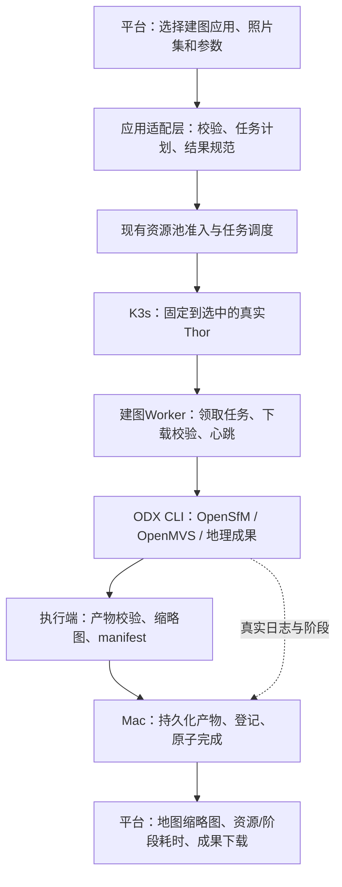
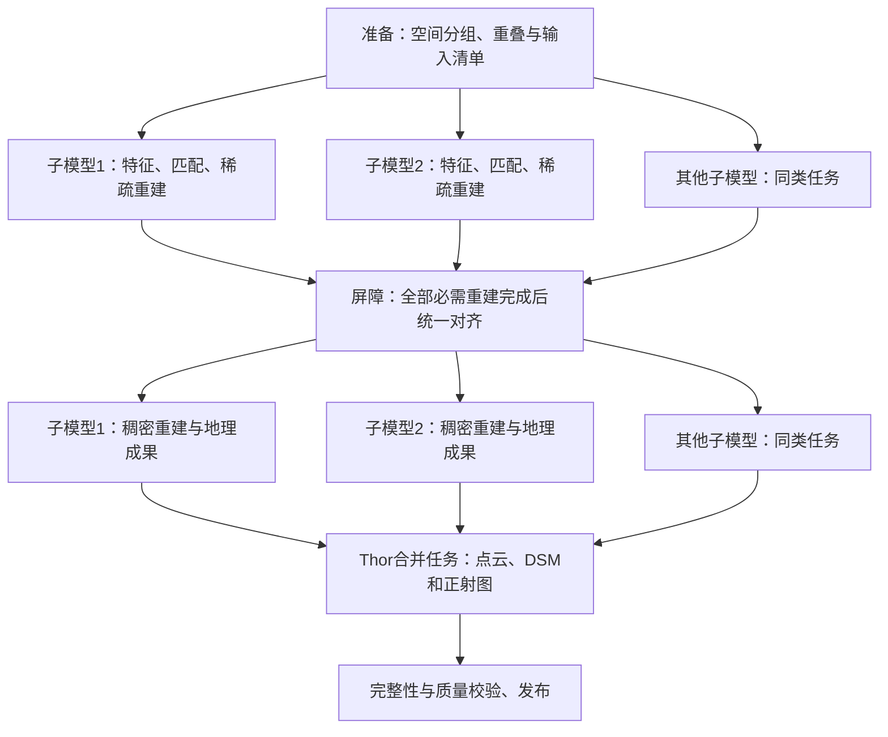

# WebODM 建图能力抽离与“样例任务二”适配方案

日期：2026年11月18日。性质：源码分析、现有平台只读核查、数据核验与拟实施设计。**本轮没有实现或运行建图任务，没有修改正在运行的平台、Thor或镜像仓库。**

## 1. 结论与边界

建议将第二类应用定义为 **“航拍照片集离线摄影测量建图”**，应用标识建议为 `aerial-mapping-odx`。第一版目标是：用户在本平台选择照片集、质量档位和成果类型，平台选一台Thor执行完整ODX重建，将真实阶段、日志、资源使用和地图成果回传到本平台。第一类视频任务继续工作。

选择的接入边界是 **ODX命令行引擎＋薄执行适配器**，而不是部署整个WebODM，也不是从WebODM的Django代码中手工搬出一份“建图函数”。尽量不修改上游摄影测量算法，先把输入、执行、事件与输出契约封装稳定；多板协同作为后续独立里程碑。

- **用户明确**：接入李倚恒负责的建图样例；通用算力平台不接管其前端及非核心服务；使用已有数据，不重新下载数据集。
- **本轮查实**：当前WebODM默认处理链为WebODM → PyODX / NodeODX → ODX；这与旧资料中的WebODM → NodeODM → ODM命名不同。不能直接据旧教程决定仓库和镜像。
- **建议**：直接接ODX CPU ARM64执行制品，先完成单任务单板闭环，再验证完整数据集，再做有重叠子模型的多板编排。
- **待李倚恒确认**：最终要求正射图/DSM/点云中的哪些成果、可接受质量与精度、是否有自定义分支/参数、是否要求完整三维纹理模型；这些不阻碍当前通用接口设计。
- **不等同**：这不是在线SLAM，不是多车在线定位，也不是把任意交通视频逐段推理后即可拼成地理地图。当前两个样例都是已采集照片集。

## 2. 本轮实际检查了什么

### 2.1 固定版本

| 对象 | 本轮固定提交/版本 | 作用 |
|---|---|---|
| WebODM/WebODM | `4084ebaacc65c082962e518beab0806dd649bb69` | 用户给定入口，提交时间2026-11-17（仓库时区） |
| WebODM/ODX | `aff8287f42006e73a51264ebef1e54dede0de3b4`，源码VERSION `3.8.6` | 本轮分析的摄影测量引擎 |
| WebODM/NodeODX | `02296467c0ca2142c2c7771876788bacbed102f6` | 引擎外围REST执行服务 |
| EinsZack/changan | `37de4c3564a053e0132ec861ec86f7e9448cd020` | 当前平台源码基线；已fetch并确认与origin/main一致 |
| Mac当前运行制品 | `/Users/eins/code/changanPlatform/releases/20261115-37de4c3` | 健康接口版本0.7.0；三台Thor在线启用 |

三个外部源码仓库仅克隆在开发服务器 `/root/projects/changan-orchestrator/tmp/research-webodm-20261118/`，没有在Mac建立业务源码副本，没有构建或运行它们。没有初始化全部C++依赖源码；算法调用关系以ODX封装代码和SuperBuild锁定项为据，不宣称已审计所有底层数值实现。

平台只读观测：三Thor均arm64、快照CPU 14核、配置内存预算65536MiB、单节点capacity=1、当前active=0。这些是既有平台快照，**不是ODX峰值内存、实测可用磁盘或并发能力结论**。

### 2.2 核查证据

- `核查证据/上游与镜像版本.json`：源码固定版本、镜像标签架构/摘要及限制。
- `核查证据/数据集只读核查.json`：压缩包/每张照片SHA256、大小、维度、相机、EXIF/GPS与非输入文件清单。
- `核查证据/现有平台只读摘要.json`：当前发布路径、健康接口与启用节点摘要。

检查方式为ZIP CRC、图像头和EXIF读取；未完整解码所有像素，未验证摄影测量重叠、配准成功率和地面精度。原压缩包未改写，未把素材或旧结果导入平台任务库。

## 3. WebODM究竟有哪些层

### 3.1 可追溯的执行链

1. WebODM的 `app/models/task.py:692` 起由 `Task.process()` 管理任务：选择处理节点、提交影像、轮询状态/控制取消、下载处理成果。
2. `nodeodm/models.py:99–141` 虽仍保留旧目录名，但已经导入 `pyodx.Node`；`process_new_task()`调用客户端 `create_task()`，不是在Django内计算特征和地图。
3. 默认Compose扩展 `docker-compose.nodeodx.yml` 使用 `webodm/nodeodx`。
4. NodeODX的 `libs/odmRunner.js:29–85` 将参数转成命令行，执行ODX目录中的 `run.sh`，捕获stdout/stderr与退出码；`libs/Task.js`还处理任务状态、队列、结果归档和可选上传。
5. ODX的 `run.py`解析命令、定位项目、检测参数变化与重跑范围，再执行 `stages/odm_app.py` 定义的实际算法流水线。

**因此，核心能力已有独立命令行边界，不必把WebODM拆坏后再重组。** 当前WebODM还允许其他处理引擎；本方案只针对已查实的ODX，不把全部引擎都算作本期适配。

### 3.2 保留、替换与排除

| 组件 | 对建图的作用 | 平台接入决策 |
|---|---|---|
| ODX `run.py`、`modules/`、`stages/` | 算法参数、阶段组织、数据读写 | 保留在执行镜像 |
| OpenSfM、OpenMVS、GDAL、PDAL、网格/纹理程序等 | 实际计算依赖 | 根据选定成果保留必要依赖；不是“非核心组件” |
| NodeODX / PyODX | HTTP任务、队列、执行和下载包装 | 首版不部署；参考契约即可，未来兼容模式可选 |
| WebODM Django、账户/项目管理、后台队列 | 应用层管理 | 不引入，使用现有算力平台 |
| WebODM前端、地图/点云查看器、插件市场 | 展示与交互 | 不整体引入；本平台做轻量成果展示 |
| WebODM配套PostgreSQL/PostGIS、Valkey、Celery、反向代理 | WebODM运行支撑 | 不作为建图任务依赖带入；平台自身已有服务保持原职责 |
| ClusterODX/历史ClusterODM接口 | 处理节点路由和分布式执行 | 首版不用，避免与平台争夺调度权 |
| 报告生成、坐标转换、缩略图 | 形成可验收成果 | 保留任务需要的部分，在执行端生成；不是删掉所有后处理 |

不建议首版自行把OpenSfM、OpenMVS、PDAL的C++算法裁成新项目。保持上游版本与运行结构，更容易复现、升级和回退。镜像“只包含建图运行栈”不等于一定很小。

## 4. 核心算法与输入输出

### 4.1 一次普通重建的阶段

`stages/odm_app.py`按条件连接阶段，以下是普通非split-merge路径的业务解释：

| 阶段 | 主要计算 | 关键依赖/中间物 | 对调度的含义 |
|---|---|---|---|
| dataset | 读取照片、EXIF、定位/控制点、相机信息 | images、照片元数据、地理参考 | 输入必须完整、照片文件名稳定 |
| opensfm | 特征提取与匹配、特征轨迹、相机位姿/稀疏重建、优化与去畸变 | OpenSfM、features/matches/tracks、reconstruction | 照片相互关联，不是独立图片分类 |
| openmvs | 多视图深度估计与稠密重建 | OpenMVS、稠密点云 | 内存/CPU密集，部分计算可GPU加速 |
| odm_filterpoints | 点云清理/筛选 | 点云工具 | 不能用结果文件简单拼接替代 |
| odm_meshing / mvs_texturing | 网格和纹理；按参数生成二维所需模型或完整三维模型 | 网格、纹理、相机 | `skip-3dmodel`不等于删除所有2.5D建图依赖 |
| odm_georeferencing | 坐标转换与地理参考结果 | GPS/GCP/投影定义、地理点云 | 统一坐标系与原点必须显式记录 |
| odm_dem / odm_orthophoto | DSM/可选DTM、正射投影和影像拼接 | GDAL/PDAL等、GeoTIFF | 结果并非普通JPEG，具有空间元数据 |
| odm_report / odm_postprocess | 质量报告、相机位置与附加成果 | 报告、shots、结果目录 | 输出清单依参数而变 |

`split`和`merge`在代码中也有阶段对象；普通数据集会走正常分支，不能把名称出现视为已经多机拆分。

这是一套摄影测量流水线，而不是一个待转换成ONNX的神经网络。基础RGB重建不需要我们的YOLOX权重；天空/背景去除、点云分类等可选功能可能依赖额外模型和下载，首版不开放，后续必须把所需资产固定并随制品离线交付。

### 4.2 输入契约

**基础必需**：有足够视角重叠的照片集，原始文件与EXIF保留。首版接RGB JPEG，按实际支持扩展，不把所有ZIP内图片都当照片。

**可选增强**：GCP控制点文件、外部定位文件、相机参数、边界范围、掩膜等；每类都要定义schema和文件角色，不能用任意路径/任意命令传入。

- 有GPS可帮助建立地理参考，不等于具备测绘级精度。
- 无GPS仍可能做相对重建，但不能伪造EPSG或宣称地理正射结果已合格；本期两个数据集均有GPS。
- 原始文件名与相机/GCP关联有意义；规范化ZIP时不随意重命名或二次压缩照片。
- 视频抽帧可作为未来独立输入适配，涉及帧间重叠、相机信息和定位补充；不直接把现有检测用视频分片逻辑复用为建图分片。

ODX规范工作目录为：

```text
/work/<task>-<attempt>/
  images/                 # 只放本次源照片
  gcp_list.txt            # 可选，不凭空生成
  geo.txt                 # 可选
  opensfm/                # 引擎中间态
  odm_georeferencing/
  odm_orthophoto/
  odm_dem/
  odm_report/
  log.json
  options.json
```

建议先以固定预设暴露参数：标准二维建图、快速预览；高级参数白名单包括特征质量、点云质量、最大并行度、正射/DEM分辨率、成果选项。正射/DEM分辨率单位为cm/pixel；最终实际分辨率与输入GSD/处理行为有关，不等同绝对精度。

### 4.3 输出契约

| 产物 | 上游典型相对路径 | 首版建议 |
|---|---|---|
| 正射影像 | `odm_orthophoto/odm_orthophoto.tif` | 标准预设必需；登记CRS、bounds、transform、分辨率、NoData |
| 地理参考点云 | `odm_georeferencing/odm_georeferenced_model.laz` | 标准预设必需；校验点数/空间范围/SRS |
| DSM | `odm_dem/dsm.tif` | 启用`dsm`的预设必需；不是地面DTM |
| DTM | `odm_dem/dtm.tif` | 后续可选，需地面分类/质量验收 |
| 处理报告 | `odm_report/report.pdf` | 标准预设建议必需；不主动启用skip-report |
| 相机与拍摄位置 | `cameras.json`、`odm_report/shots.geojson` | 质量分析/轻量预览；文件有效性仍需验证 |
| 三维纹理模型 | `odm_texturing/odm_textured_model_geo.obj`及纹理等 | 本期暂不作为默认输出；不能只交OBJ漏掉配套纹理 |
| 原始日志与参数 | stdout/stderr、`log.json`、`options.json` | 必需审计材料，失败任务也尽量保留 |
| 平台manifest与缩略图 | 由适配器生成 | 绑定任务、尝试、节点、镜像、输入/参数摘要与每个产物摘要 |

不要把整个项目工作目录当最终结果上传。源照片已有存储引用；庞大的features、depthmap等按检查点策略保存，避免重复回传及堆积磁盘。

`--fast-orthophoto`明确跳过稠密重建和完整三维模型，从稀疏重建生成正射图；适合快速检查，但不是标准稠密成果的等价替代。不能拿快速档对比另一边的完整重建并宣称平台加速。

## 5. 已有数据集核查

| 数据集 | 实际位置与输入选择 | 查实数据 | 用途 |
|---|---|---|---|
| Aukerman | `/Users/eins/code/changanPlatform/odm_data_aukerman-master (2).zip`；只取`park22/*.JPG` | 77张，4896×3672，SONY DSC-WX220；77张含GPS经纬度及高度字段；ZIP约518.36MiB | 用户指定平台目录已有数据，完整建图主样例 |
| Brighton Beach | `/Users/eins/研三上/长安汽车项目/drone_dataset_brighton_beach-master.zip`；只取`images/*.JPG` | 18张，4000×2250，DJI FC300S；18张含GPS经纬度及高度字段；ZIP约66.22MiB | 已在本地资料目录，可用于更快的首次链路验证，不重新下载 |

Aukerman压缩包SHA256：`1bac6ff30f9993ca89533c2def46255e01863a07b0c2c65a0c159ff75cde527f`。
Brighton压缩包SHA256：`1c16cb6532760b2ecad1f787e48e88f8033d7e8d7177656f8578e115c16d6dd4`。

注意事项：

1. Aukerman根目录`aukerman.png`是包内示例图；Brighton根目录`brighton_beach.jpg`、`dsm.tif`、`model.laz`为既有展示/结果。它们只能作为参考材料，**不得进入照片集或冒充此次产物**。
2. 两包ZIP CRC检查均未发现错误。Pillow把这些带多图像信息的JPG识别为MPO；应保留源文件和EXIF，在目标引擎验证实际读取，不为改后缀而重新编码。
3. 包内未发现GCP或独立检查点文件。EXIF时间分别为2016年的采集时间，不是2026年的现场采集或本平台实测。
4. Aukerman总像素约13.84亿；压缩包只有约0.5GiB不代表重建内存只需要0.5GiB。未据此估算或宣称精确峰值。
5. 只检查了元数据，不保证航线重叠及每张照片都会成功参与重建；由李倚恒结合报告确认有效照片数、几何完整性与质量。
6. 压缩包分别携带CC0 1.0与BSD 2-Clause文本，交付保留相应说明；不把许可证存在理解为第三方已给出精度保证。

## 6. 对现有平台源码的适配差距

现有平台已经有真实Thor、K3s任务、身份校验、状态跟踪、重试/取消、镜像仓库和资源池准入，但应用层仍明显绑定视频。**不是只增加一个镜像下拉框就能接入建图。**

下表以服务器源码 `/root/projects/changan-orchestrator/` 下的基线提交为准：

| 位置 | 当前代码事实 | 建图需要的改动 |
|---|---|---|
| `app/main.py:114–126` | 上传保存为`.mp4`，上限512MiB，立即读取视频元数据 | 数据集入口＋安全ZIP预检/清单；Aukerman原包已超过现有上限 |
| `app/schemas.py:3–25` | TaskInput含segment_seconds、sample_fps、confidence；extra=forbid；默认超时短 | 版本化通用任务字段与应用参数schema；长任务超时独立配置 |
| `app/engine.py:34–69` | create仅允许video-analysis；prepare实际切视频，写segments的start/end/path | ApplicationAdapter.validate/plan；建图首版一项完整工作单元，不制造时间分片 |
| `app/scheduler.py:18`及其评分 | 要求固定MODEL_ID兼容，含视频时长/采样FPS与measured_fps估计 | 按application capability、CPU/RAM/磁盘/架构准入；不能用YOLOX FPS预测摄影测量 |
| `app/container_execution.py`的application/制品选择 | 固定视频模型/镜像契约 | 应用注册与不可变制品快照，模型摘要改为按应用可选 |
| `app/kube.py:74–95` | 容器名video，CPU请求1/限额2，`/work`2GiB，`/tmp`128MiB，只读rootfs | 按应用资源画像构造Job；CPU/内存/临时盘/GPU请求与平台预留一致 |
| `app/kube.py:97–113` | 会话gpu_access时设置nvidia RuntimeClass和GPU=1 | CPU建图不得因节点有GPU就占一张GPU；GPU策略按应用决定 |
| `workers/container_entry.py:82–93` | 加载YOLOX并上报model_loaded/ready | 新的batch worker启动ODX子进程，不加载YOLOX，不伪造model_loaded |
| `app/session_execution.py:478–506` | 参数固定采样FPS/置信度；结果必须有frames/counts与三个预览名之一 | 按application校验result manifest；不能塞进counts/frames冒充视频结果 |
| `app/container_execution.py:290–315` | 仅三个preview JPG，单件8MiB；含摘要与不可变发布保护 | 大文件流式/分块上传、成果类型白名单与原子登记，保留原有身份保护 |
| `app/engine.py:251–266` | 聚合视频帧/计数与时间偏移 | 按应用汇总；建图首版仅验收单次结果，后续地图合并必须真实计算 |
| `web/`任务提交/详情/成果与资源页 | 当前以视频参数/检测预览为主 | 增加应用选择、照片数据集、阶段详情、成果目录及轻量地图预览 |

不修改源码即可完成的是本轮调研；上表改动均未实施。

## 7. 推荐接入架构



这里不运行WebODM、NodeODX或第二套调度器；Mac负责控制与保存结果，重建、点云/DEM合并和较重的成果转换都在Thor。Mac不得悄悄承担重建，再把任务归功于车群。

### 7.1 通用部分与应用部分

**平台通用**：输入对象登记、任务/尝试身份、资源准入、K3s落点、租约、心跳、取消、可靠回调、产物持久化与审计。

**应用适配器**：输入校验、计划生成、参数白名单、执行命令构造、阶段解释、必需产物列表、结果校验与展示摘要。

建议接口为 `validate_input → plan → build_execution → parse_event → validate_outputs → summarize`；名称是设计建议，不是已存在函数。现有视频收敛为第一个适配器，ODX是第二个，核心调度不应遍布 `if odx`。

通用对象至少包括：

- application：ID/版本、平台协议版本、镜像digest、引擎版本、参数schema、CPU/GPU/架构要求、输出规范版本。
- dataset/input：照片文件清单、大小/摘要、来源角色、相机/GPS摘要、对象URI；URI不是任意服务器文件路径。
- work_unit：kind、输入引用、资源请求、预期输出、依赖；首版建图只有一个batch单元。
- attempt：继承task/attempt/actual_node/PodUID/JobUID及租约，另绑定application/input/parameter摘要。
- artifact：逻辑名称、角色、MIME、大小、SHA256、不可变存储引用、空间元数据和有效尝试身份。

数据库迁移建议采用新增通用`work_units`、输入与产物记录，保留旧`segments`及历史API兼容层，逐步把视频映射为video_segment工作单元。不能用start=0/end=1造一个“视频片段”永久承载建图。先冻结迁移/回滚方式，避免同时重写全部历史任务表。

第一版无需先实现任意用户DAG编辑器；采用两个固定应用模板和明确契约即可。

### 7.2 一次性Job，而不是视频模型复用会话

建图一次输入就是一个项目，前后阶段共享大工作目录。首版采用 `execution_mode=batch_job`：一个attempt对应一个Job/Pod，整个重建过程留在同一Thor；应用阶段不是每次都创建新容器。

复用现有安全与可靠性设计，不直接照搬视频ready/next/frames协议。该模式无“模型加载一次处理多个片段”的必要性；后续检查点恢复也不是复用YOLOX常驻容器。

示意调用（**只说明命令边界，本轮未执行；资源与参数需单板试验后冻结**）：

```text
python3 /code/run.py --project-path /work <task-attempt-project> \
  --no-gpu --max-concurrency 4 --feature-quality medium \
  --pc-quality low --skip-3dmodel --dsm \
  --orthophoto-resolution 10 --dem-resolution 10
```

由适配器以参数数组启动，不使用用户提供的shell命令。固定上游制品、运行目录和受控参数；`HOME`、`TMPDIR`、工作目录和缓存挂载可写。先验证non-root＋只读根文件系统兼容，不为解决权限问题默认升级为privileged。

### 7.3 不重复造两套资源/任务系统

节点资格仍走资源池＋调度器；状态仍以本平台attempt为权威。NodeODX的内部队列、自动重启和ClusterODX的路由不能绕开平台再调度一层，否则选定Thor、实际节点、资源预留和结果归属容易不一致。

备选是“单次Job里放NodeODX并以localhost调用”，可减少命令包装工作，但多了REST服务、内部状态和清理逻辑；对于已具备K3s任务控制的平台，收益不如直接CLI明显。只有未来必须兼容既有NodeODX节点时再做该后端。

## 8. ARM64与GPU：先验证什么

- ODX源码CPU发布工作流同时构建linux/amd64和linux/arm64；当日Docker Hub `webodm/odx:latest`元数据确有这两种架构。
- 上游GPU Dockerfile基于CUDA 12.9.1，GPU发布工作流只列linux/amd64；当日`:gpu`标签元数据也只见amd64。**不能把现成`:gpu`直接当成Thor镜像**。
- 镜像标签可能变化，实施时固定manifest/platform digest，并核对镜像内部版本及构建溯源。当前标签摘要不能自动证明其来自本轮源码HEAD。
- Thor的Jetson用户态、驱动、CUDA、OpenMVS/OpenSfM编译目标与GPU架构兼容需要真实验证；“有arm64镜像”只解决指令集之一，不是GPU兼容证明。
- ODX的`has_gpu()`在Linux上会以`nvidia-smi`是否存在做检测；`openmvs.py`某些GPU失败会再走CPU。GPU页面必须报告实际阶段后端和降级原因，不能把检测到设备当作执行成功。

**推荐门槛**：先用CPU ARM64、GPU请求0、显式`--no-gpu`跑完整小样例，测量CPU时间、峰值统一内存、磁盘峰值与传输；再决定是否值得专门构建Thor GPU变体。

GPU加速不是全流水线加速：重建中有大量CPU/IO步骤。源码`modules/osfm.py:290–302`还显示自动GPU匹配受照片数量等条件影响（当前代码对≥32张才选该自动路径）；18张小集与77张集不能只按“同样GPU开关”直接比较。

本轮未安装依赖、拉取镜像、消耗Thor执行资源或做性能测试。资源规格暂不承诺。首次探测可以将并发限制在4，并为批任务单独设置RAM/临时盘预算与小时级时间上限；**预算必须在单板测量后冻结，不沿用视频的2GiB工作盘和300秒默认attempt超时**。

## 9. 进度、产物和长任务可靠性

### 9.1 真实进度

ODX `modules/progress.py`向本机UDP 6367发进度；`modules/types.py:438–485`记录阶段起止并计算阶段权重进度。适配器可在Pod内接收UDP，同时读取stdout的阶段日志，映射为有时间戳事件。

- 显示“当前阶段＋该阶段真实起止/耗时”；没有可信阶段内计数时用运行中，不自增百分比。
- 上游百分比是阶段权重估计，不是剩余时间百分比；原样保留为`engine_progress`并明确含义。
- UDP可能丢包，不能作为完成依据；用退出状态、产物和最终日志复核。
- `log.json`不应被假定为实时持续落盘的事件流；本版本logger会积累结构化状态并关闭时写出。实时以stdout/UDP为主，固定版本的解析器应有测试。
- 心跳线程独立于重建子进程；长时间没有stdout不等于失联。阶段事件中保留task_id、work_unit_id、attempt_id、PodUID、seq。
- `UPLOADING/VALIDATING`是平台阶段；引擎进度100%不等于平台完成。

### 9.2 结果成功条件

建议“退出码0＋引擎成功信息＋所有必需产物通过校验并持久化＋有效attempt原子提交”。若参数主动跳过产物，模板应先改变预期清单；缺失必需成果不能靠退出码0放过。

至少校验：GeoTIFF可读、有合理范围/非空像素、CRS/单位/NoData可解释；点云可读且点数非零；照片参与重建数与未参与清单；实际结果对应固定输入、参数与镜像。**有效重建比例/允许误差由算法负责人确定，不默认100%，也不擅自设成保证精度的阈值。** 无独立检查点时，只报告内部误差和视觉质量，不写地面绝对精度达标。

上传沿用attempt级鉴权与不可变产物思想：流式/分块、大小配额、服务端复算摘要、临时文件完成后原子发布；manifest仅引用已落盘对象。GeoTIFF支持下载与按需Range读取；首版缩略图在执行端生成，完整点云先下载，不引入整套Potree/地图服务。缩略图只是预览，不代替空间成果校验。

### 9.3 取消与恢复

- 取消向ODX及子进程组发送终止信号，限时后强制停止，核对Job/Pod消失后释放占用；不能只停止HTTP回调而让OpenMVS继续运行。
- 重试使用新的attempt目录与凭据；旧attempt成果/回调不能覆盖新结果。上传中取消同样重新核对所有权。
- 首版只承诺全任务重跑；不要因上游有`--rerun-from`就宣传跨节点自动续跑。恢复需要相同输入、引擎/依赖版本、参数及完整中间目录。
- 上游`--end-with`、`--rerun-from`和参数变更检测可以辅助恢复，但不能从任意深度图或单个文件续跑。
- `emptyDir`随Pod删除消失；如启用断点，必须有明确的节点本地保留或远端检查点，注明跨节点是否可用。checkpoint key至少包含数据、参数、镜像/引擎与阶段版本。
- 对OOM、磁盘满、照片配准失败、回传失败、租约丢失分别编码；回传失败优先重传已有产物，不能无条件重新做几小时建图。
- ODX产生大文件时磁盘配额、过期清理与并发预约必须落地；不能因CPU空闲就无限并发。

## 10. 如何走向三Thor协同：不是把照片平均三分

### 10.1 先区分三种演示

1. **单任务在一台Thor执行**：证明第二类真实应用接入与选点，其他节点不参与该任务计算。
2. **多个独立建图任务分发到不同Thor**：证明平台支持建图批任务并发，不能称为同一张地图协同重建。
3. **同一照片集拆成重叠子模型并联合重建**：才是本节的单任务多节点协同，需要额外算法与工作流适配。

上述是**平台演示的三种层次**，不是既有《整体技术方案书》第10.2节的三个项目对照组。项目对照组为：单芯片基线（对应第一类）、单车座舱/智驾跨域（由李倚恒确认两域如何拆分，需独立域端证据）、车群算力池（第三类）。第二类仅表示批任务并发，不能代替任何跨域或同图协同的证据。比较时使用相同输入、引擎版本、成果要求与质量门槛。

Brighton18张用于第一类；Aukerman77张先完成整体基线。77张是否值得拆成多个子模型需检查空间覆盖和耗时，可能因重复计算/传输而更慢；不承诺三板加速。

### 10.2 上游拆分代码实际做了什么

`stages/splitmerge.py`读取GPS或显式image_groups，将照片空间分组并增加重叠。`--split`表示平均每个子模型的照片数量，不是节点数量；`--split-overlap`表示米制重叠半径，不是重复图片张数。默认重叠150m不能机械用于这两个小数据集。

其处理次序是：创建子模型 → 各子模型稀疏重建 → **对齐子模型重建** → 各子模型后续稠密/地理成果 → 点云/DEM/正射图融合。`modules/remote.py:442–511`把远程工作分为`ReconstructionTask`与`ToolchainTask`，通过种子文件和结果清单传递阶段状态，可作为我们定义工作单元的直接依据。

两个容易误判的点：

- `--end-with split`并不只是生成分组清单：此版本split阶段本身会调用子模型重建、对齐和后续工具链。因此不能仅靠已有CLI开关就宣称已拆出可单独调度的prepare任务。
- `LocalRemoteExecutor`还会执行本地任务；直接把`--sm-cluster`挂在Mac上运行可能让Mac承担计算。应在Thor执行协调/计算单元，或用我们自己的显式DAG执行器取代这一层路由，不使平台选点失效。

### 10.3 推荐后续DAG



子模型数不强制等于3；平台在三个节点之间调度就绪工作。相机/坐标参考、特征轨迹、重叠区域和重建变换要一起传递，不能把三块独立OBJ或图片直接拼接。

实现需要在固定版本ODX上封装prepare/reconstruct/align/toolchain/merge入口，重用其OSFMContext与相关函数，必要时维护最小可追踪补丁；不把内部中间格式误认为跨版本稳定API。三Thor未配置共享POSIX文件系统，阶段数据需显式归档、校验、上传和按需下载；计算节点必须计入这些传输耗时。

上游split/merge存在“部分子模型无对齐结果则跳过”和某些合并错误记warning继续的代码分支。平台必须记录预期子模型清单、实际完成清单与覆盖情况，**不能把上游最终退出0直接当成全量协同成功**。不足的部分应失败或标记明确的部分成果，不能复用视频的coverage=1常量。

该原生合并接口主要面向pointcloud/orthophoto/dem，不把“完整三维纹理网格无缝合并”作为已支持事实。若李倚恒要求完整纹理模型协同，需要单独验证。

## 11. 实施顺序与退出条件

按验证门槛推进，不把推测耗时写成开发承诺。建议按以下顺序组织实际开发：

| 阶段 | 实际工作 | 完成证据/退出条件 |
|---|---|---|
| G0 接口冻结 | 李倚恒确认成果/参数/验收；固定ODX源码、镜像、数据清单和许可证清单 | 可复现单机输入输出契约；无未解释的外部模型下载 |
| G1 引擎验证 | 服务器准备/测试ARM64制品；Thor CPU跑Brighton18，再Aukerman77 | 原始日志、真实产物、镜像digest、节点/时间/内存/磁盘/后端记录；失败原因明确 |
| G2 平台通用最小扩展 | 适配器、数据集/大产物、batch Job和资源声明；视频兼容迁移 | 单元/API/隔离集成测试通过，旧视频任务与历史数据保持兼容 |
| G3 第二样例闭环 | 平台提交→选Thor→执行→阶段回传→真实成果/预览 | 从浏览器提交到下载结果全链路；取消、重复回调、缺产物/坏摘要等反例通过 |
| G4 多任务与基准 | 固定参数重跑、跨节点独立任务调度；冷/热镜像分开记录 | 输入/参数/资源可比，时间拆分真实，不混淆批吞吐与单任务加速 |
| G5 单图三板协同 | 重叠分组、两波并行、全局对齐/融合、依赖与检查点 | 同数据同参数整体基线对照；输出质量、完整性、传输与失败恢复一并验证 |
| G6 GPU专项 | 若CPU结果/时间表明有收益，再做Thor GPU构建与回退观测 | 实际GPU阶段证据、兼容性与同条件结果；不作为G3上线硬前提 |

G1是技术可行性的第一道门，不能花大量时间完成平台页面后才发现引擎/磁盘不适配。G1的独立CLI执行是验证，不能当成G3已交付。

### 11.1 开发写集建议（均尚未创建/修改）

- 通用应用：新增应用描述/适配器模块，调整 `app/schemas.py`、`app/engine.py`、`app/scheduler.py`、数据迁移。
- 批执行：新增ODX worker与batch执行路由，按应用改造 `app/kube.py`；复用而不破坏视频会话。
- 数据与成果：新增dataset/artifact服务，替换“只有MP4和三张JPG”的限制，保留旧端点兼容。
- 制品：增加固定ODX基础镜像＋适配器的ARM64 Dockerfile和构建/验收脚本；不在Thor安装开发工具链，不在Mac建立Git业务副本。
- 前端：应用选择、照片集摘要、阶段时间轴、真实成果目录；首版只增加必要轻量预览，不复制WebODM全站。
- 测试：ZIP穿越/软链接/解压炸弹、GPS/角色/摘要、参数白名单、生命周期、取消/失联、不可变产物、旧视频回归，以及真实Thor端到端。

### 11.2 用例与指标

成功用例必须同时有：正确照片数、固定参数与输入hash、实际节点/Pod身份、真实阶段、引擎退出状态、必需成果、下载后复算hash及空间有效性。

反例至少包括：只上传旧成图无照片；ZIP含越界路径；必需产物缺失；回调/产物摘要不匹配；取消时子进程仍运行；旧attempt迟到；输入或参数改变却复用旧检查点；节点失联；OOM/磁盘满；上传中断；合并缺子模型。

计时分开：排队、镜像准备、输入传输/解包、算法各阶段、校验/预览、输出回传、平台确认。资源记录包括CPU、内存峰值与统一内存口径、磁盘峰值、网络双向字节。单板/多板对比用同一数据、质量档位和成果，GPU/CPU及冷启动状态分别标注；以质量可接受为前提计算加速比。

## 12. 分工建议

- **李倚恒**：确认算法版本/自定义部分、照片适用性、质量预设、GCP/坐标规则、结果验收及空间拆分/对齐/合并的正确性。
- **方雍**：应用协议、任务/依赖编排、选点、尝试与可靠性、大文件闭环、平台进度与结果页、基线测量。
- **资源池/基础设施同学**：节点资源与能力上报、CPU/内存/临时盘/GPU约束、K3s及镜像/网络基础条件；双方确认预约和清理口径。

这是本轮建议分工，不替代组内确认。平台不承诺算法质量，算法提供方也不另建一套绕过平台的调度系统。

## 13. 发布、授权与风险清单

1. 上游三仓库均附AGPLv3许可证文本；镜像交付需要保留许可证、来源、固定版本和补丁，并核对依赖授权。容器/CLI隔离不自动构成许可证义务豁免；正式对外交付前做授权审核，本报告不作法律结论。
2. 原始ZIP含外部不可信路径：拒绝绝对路径、`..`、symlink/hardlink、同名覆盖，限制文件数/总展开量/压缩比，检查文件签名和角色。照片处理程序同样应在受限非特权容器内执行。
3. 算法版本与结果目录/参数schema绑定；不能用浮动latest发布。源码版本、镜像digest及运行时报告分别记录。
4. Mac只管理发布制品和数据；业务源码/测试/ARM64构建继续在服务器，验证后按GitHub提交推送。未经部署操作不改变current。
5. 三Thor不等于四节点验收；本轮更未新增任何真实建图验收或性能数据。只读健康检查也不等于建图成功。

## 14. 一手源码索引

以下链接固定到本轮检查提交；行号见前文。仓库内仍有`odm_`、`nodeodm`与ClusterODM等历史名称，分析按实际调用关系而不是名称判断。

- WebODM定位与当前引擎：https://github.com/WebODM/WebODM/blob/4084ebaacc65c082962e518beab0806dd649bb69/README.md
- WebODM任务管理：https://github.com/WebODM/WebODM/blob/4084ebaacc65c082962e518beab0806dd649bb69/app/models/task.py
- 处理节点客户端：https://github.com/WebODM/WebODM/blob/4084ebaacc65c082962e518beab0806dd649bb69/nodeodm/models.py
- NodeODX启动引擎：https://github.com/WebODM/NodeODX/blob/02296467c0ca2142c2c7771876788bacbed102f6/libs/odmRunner.js
- ODX入口：https://github.com/WebODM/ODX/blob/aff8287f42006e73a51264ebef1e54dede0de3b4/run.py
- ODX流水线：https://github.com/WebODM/ODX/blob/aff8287f42006e73a51264ebef1e54dede0de3b4/stages/odm_app.py
- ODX参数：https://github.com/WebODM/ODX/blob/aff8287f42006e73a51264ebef1e54dede0de3b4/modules/config.py
- OpenSfM封装：https://github.com/WebODM/ODX/blob/aff8287f42006e73a51264ebef1e54dede0de3b4/modules/osfm.py
- 拆分/对齐/融合：https://github.com/WebODM/ODX/blob/aff8287f42006e73a51264ebef1e54dede0de3b4/stages/splitmerge.py
- 远程阶段清单：https://github.com/WebODM/ODX/blob/aff8287f42006e73a51264ebef1e54dede0de3b4/modules/remote.py
- GPU发布配置：https://github.com/WebODM/ODX/blob/aff8287f42006e73a51264ebef1e54dede0de3b4/.github/workflows/publish-docker-gpu.yml
- CPU发布配置：https://github.com/WebODM/ODX/blob/aff8287f42006e73a51264ebef1e54dede0de3b4/.github/workflows/publish-docker.yml
- 镜像元数据来源：https://hub.docker.com/v2/repositories/webodm/odx/tags/latest 与 https://hub.docker.com/v2/repositories/webodm/odx/tags/gpu （本次结果见JSON，未来可变）

---

**本轮交付边界**：已完成固定版本源码调用链、现平台差距、两个本地数据集核验、单板与多板接入设计；未实现适配器/页面/大文件接口，未构建或拉取ODX镜像，未运行单板/三板建图，未得到性能或精度结论。下一步优先G0/G1，随后实施G2/G3，不直接跳到三板拆图。
