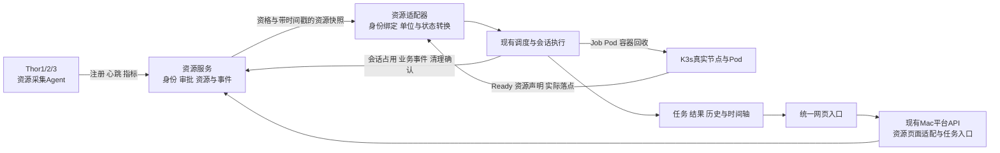

# 节点管理平台代码评估与集成计划

日期：2026年11月15日。评估对象：顾强强的 `1234gu/changan_vehicular` 与方雍的 `EinsZack/changan`。本轮完成源码审阅、隔离行为核验和计划编制，尚未实施两套平台的业务集成。

## 1. 建议结论

建议采纳“以现有调度执行平台为基础形成统一产品”的方向，但调整为：**选择性复用他的 Agent、节点管理和资源服务，重新适配与调度器相接的部分，并把资源界面整合进现有平台。暂不全量重写，也不直接整仓合并。**

这项建议有三个层次：

1. **产品层统一**：最终由现有平台提供一个网页入口，增加节点、资源池及集群视图，任务提交、调度决策、执行过程和结果继续使用现有链路。
2. **代码层受控复用**：先冻结对方提交，复用有价值的模块及数据契约；通过独立命名空间和来源记录纳入自己的版本管理，不以每次追随对方仓库更新为运行前提。整合不是把两个仓库的根目录、依赖清单和入口直接混在一起。
3. **运行层允许模块独立**：第一阶段用独立资源服务和薄适配层验证；通过后可以把它随现有平台一起发布、启停。一个产品入口不要求一个 Python 进程或一份数据库。

判断依据不是“两人独立开发所以必然难对接”。源码已有清楚的资源服务边界、候选查询和执行投影接口，现有平台也有资源适配入口。真正需要解决的是身份、资源记账、状态与清理、采集质量及前端依赖，而这些问题即使全量重写也必须解决。

## 2. 本次实际检查范围

| 项目 | 核对结果 |
|---|---|
| 对方源码 | 已在服务器克隆至 `/root/projects/integration-reviews/changan_vehicular-20261115`，固定提交 `b964ad133e30673bbfcbfc1cc6e5bd62587632f4` |
| 对方仓库形态 | 当前 main 只有一次上传提交；169个受管文件。后端26个Python文件、5,135行；Agent 20个Python文件、2,141行；src下85个TS/TSX/CSS文件、12,561行 |
| 己方源码 | 在业务工作区执行 `git pull --ff-only origin main`，评估基线 `92eed9d3e91e9e8858bdd258a1b98453325e22dc`，开始时工作区干净 |
| 己方运行端 | Mac健康接口返回0.5.2；只读节点接口显示thor1/2/3在线且启用，旧lab节点停用；未配置外部资源服务地址 |
| 隔离行为核验 | 使用既有changan-orchestrator专用环境、进程内ASGI请求和临时/内存SQLite，完成14项行为核验；47个Python文件语法解析通过 |
| Thor只读检查 | 在Thor1执行对方采集器使用的同一条nvidia-smi查询，识别到NVIDIA Thor，但三项显存字段均为[N/A] |
| 未做事项 | 没有在Thor安装/运行对方Agent，没有部署其后台或前端，没有修改现有业务配置、创建真实任务或重启服务，没有完成两平台端到端联调 |

14项核验是对当前行为的复现，其中包含缺陷和缺口，**不代表对方平台14项质量测试通过，更不代表真实车端验收通过**。除单独保存的Thor1查询和己方节点读取外，核验中的所有节点、资源和任务均为人工构造的隔离数据。

仓库没有随附README提到的backend/tests、agent/tests、Linux构建工作流和部分0_docs文档；不能据README中的测试和实机表述推定本次快照已获验证。本轮未运行对方前端构建；服务器现有Node为24.14.1，而其package.json限定22.12以上、23以下，前端须在匹配环境补做构建和浏览器核验。

## 3. 两个项目实际提供什么

### 3.1 对方项目

`vehicular/`下是三个相对独立的模块：

| 模块 | 源码中确认的能力 | 本轮判断 |
|---|---|---|
| Agent | 稳定UUID、设备指纹、主动注册、心跳、CPU/内存/存储/网络和NVIDIA GPU采集、失败重试 | 可保留主体；需Thor采集适配及部署验证 |
| Backend | FastAPI/Pydantic、SQLite、审批/拒绝、暂停调度、移出/重入资源池、生命周期事件、集群归属、资源聚合 | 有实际业务价值，优先复用 |
| 候选目录 | POST /api/v1/compute-pool/candidates，按审批、成员关系、健康、资源、架构和标签返回候选及排除理由 | 适合资源资格查询，不能等同原子预留或最终调度 |
| 执行投影 | 接收外部调度事件、按版本和事件ID去重、保存执行列表、接受全量快照 | 可用于资源页展示，但需修正快照覆盖和会话记账语义 |
| Frontend | React18、TypeScript、Ant Design、Router、ECharts；总览、节点、资源池、集群和候选/执行列表 | 页面结构、类型和交互可以复用；入口、样式、任务数据及服务调用需整合 |

“集群管理”目前主要是数据库中的集群档案和节点归属，不是K3s集群创建、升级、加入或删除控制器。工作负载、网络、存储镜像和系统监控路由指向ComingSoonPage。调度提交函数明确抛出“Scheduler提交服务未配置”，并未实现真实调度执行。总览中的任务统计仍为固定零占位。这些内容不能按菜单数量计为已实现功能。

### 3.2 己方平台

已核查源码中的视频任务、基础调度、会话执行、Pod身份核验、结果校验和清理链路。既有三Thor交付记录支持真实CUDA视频执行、每任务每节点一个容器、模型在该容器中加载一次并复用、终态后清理。

资源状态目前主要来自Kubernetes Ready/资源配置、既有任务占用和下载观测。固定内存标签是预算，并非实时物理可用内存。自己的短板恰好是对方已有的节点审批、细粒度采集和资源管理界面，所以没有充分理由重做全部资源平台。

现有ResourceProvider不是空白，但它期待GET /nodes数组以及POST/DELETE /reservations。会话模式会在启动容器前调用一次预留，清理完成后释放。对方不存在这些路由，不能仅填写环境变量即接通。

## 4. 已确认的集成问题

| 问题 | 实际证据与后果 | 处理方向 |
|---|---|---|
| 节点身份不同 | 对方物理节点ID是UUID，己方为thor1/2/3，另有Kubernetes节点名和UID；GPU UUID在既有三板核查中相同 | 建立经硬件核对的显式映射，不按IP、hostname或GPU UUID猜测合并 |
| 执行模式含义不同 | 对方SINGLE_NODE/DISTRIBUTED描述资源需求满足方式，己方task_session描述容器生命周期 | 逐节点校验完整模型/容器需求，再由己方分配视频片段；不能只校验全池总内存/GPU数量 |
| 资源接口不同 | 己方GET /nodes和POST /reservations在对方均返回404；对方返回候选对象和排除原因 | 编写适配器，明确只读资格查询与资源准入能力；不造一个永远成功的预留接口 |
| Thor显存不可直接采 | Thor1同命令输出[N/A]；对方解析后单设备显存为None，汇总表达式将其变为0 | 保留未知值，适配Thor可验证的系统/GPU指标；统一内存不得当作独立显存再相加 |
| 运行时内存与记账内存不同 | 构造总内存16GiB、实际可用0.25GiB、请求2GiB，候选仍通过；候选available是总量减执行投影，实际可用放在advisory | 新会话准入同时考虑预算、实际余量、待启动承诺及K3s声明，统一扣减口径 |
| 采样时效不充分 | 一小时前的collected_at现在上报，节点仍ONLINE且进入候选；服务使用接收时间last_resource_at判断过期 | 同时校验采样、接收、心跳时间与时钟偏差，不能以查询生成时间刷新旧数据 |
| 汇总与候选口径不一致 | 一个GPU已有RUNNING占用时，候选数为0，summary仍给allocated=1和schedulable_available=1 | 分开展示物理总量、资格容量、已承诺量和当前可接纳量，统一术语 |
| 普通事件保护不等于快照保护 | 单事件重复和旧版本会被拒绝；但旧全量快照能把v12 SUCCEEDED覆盖成v1 RUNNING | 加快照来源、完整性、epoch/watermark及逐对象版本保护 |
| LOST会释放记账 | 投影转LOST后GPU立即重新成为候选；对方没有己方cleanup_state语义 | 网络分区和业务终态不等于容器已停，未核实清理前保留占用 |
| 会话复用易被重复扣减 | 对方以attempt为投影键，己方一个会话包含多个分片attempt | 资源按会话计一次，分片仅记业务进度；避免自有会话被外部忙碌标记挡住 |
| 缺少真实预留协议 | 候选查询只读，snapshot_id每次随机生成；没有版本条件预留、租约或竞争提交 | 初期明确单调度器本地准入范围；多调度器共享前再实现真正原子预留 |
| 前端不能直接拼接 | React18/19、Vite8/6、TS/JS、两套路由/根入口和全局CSS不同 | 只迁移所需页面及类型，统一导航/请求/样式，逐页验证 |
| 运维边界不同 | 对方集群是逻辑归属，接入Agent不等于加入K3s，资源接口也没有节点凭据认证 | 物理资源、可执行节点分开展示；正式接入补认证与配置，不照抄run_all.py |

节点和资源池页面的hook主要在进入/手动刷新时加载，总览才有5秒订阅轮询；统一页面时须补自动刷新和数据年龄提示，不能仅移植静态布局。

对方Agent的5秒资源间隔是在“采集+上报”完成后再等待5秒，不能直接证明≤5秒采集周期或感知延迟。网卡收发速率是实际流量，link_speed是标称链路速率，均不能直接替代己方调度中的有效下载带宽。

己方也有需改进之处：容器刷新时一个节点缺少资源池映射，可能落入整体异常处理，影响所有节点；适配时应将单节点映射异常与资源服务整体不可用分开。CPU设备策略仍可能声明GPU名额的问题已在前轮记录，不能随此次整合遗漏。

具体源码定位见[代码核查索引](代码核查索引.md)，复现结果见[evidence/behavior-results.json](evidence/behavior-results.json)。

## 5. 四种路径比较

以下为工程判断，不是实测工期。

| 路径 | 优点 | 主要代价 | 评价 |
|---|---|---|---|
| 两个平台仅做接口对接 | 各自维护边界清楚，容易独立回退 | 仍需解决相同的数据语义问题；用户入口和样式分裂 | 适合作为第一阶段验证方式 |
| 整仓直接合并 | 表面上代码集中 | app包名、入口、依赖、数据、路由和状态权威冲突，带入未完成页面及模拟分支 | 不建议 |
| 在己方全量重新实现 | 最终风格和架构可完全自主 | 重做注册、审批、指纹恢复、持久化、Agent分发和页面；还需补同样的Thor及一致性验证 | 当前证据不支持，容易挤占中期稳定性验证 |
| 选择性移植+适配+统一界面 | 保留已有业务逻辑；最终由己方平台独立发布；改动集中在真实差异 | 需维护来源版本、模块边界和两类状态的一致性 | 推荐的目标路径 |

全量重写只有在“模块无法独立运行、质量修复成本明显高于复用、来源授权无法落实，或后续需求使原模型整体不再适用”时才值得重新评估。本轮源码和隔离结果尚不支持直接作此判断。

## 6. 建议目标架构

以下均为待实现设计：

- **资源服务权威**：物理节点身份、审批、池成员关系、管理员调度开关、采集值及其时间。
- **调度平台权威**：任务/分片/尝试/会话、分配、重试、取消、有效结果、容器清理及任务统计。
- **K3s权威**：实际节点Ready、可分配设备声明、Job/Pod及实际落点。K3s注册和Agent注册分别成立，不能互相代替。
- **执行投影只是副本**：资源页订阅调度端的可重放事件；投影故障不得覆盖调度事实或直接释放未核实占用。
- **唯一资源承诺口径**：第一阶段由现有单调度器对本平台会话做持久化准入，K3s负责实际Pod资源约束；暂不声称跨多个调度器的全局原子资源预留。今后若资源池要服务多个任务源，新增真正的预留/租约服务再切换权威。
- **统一发布**：代码、测试和Linux ARM64制品继续在服务器完成；Mac只部署发布包和数据，以changan-platform环境原生运行；Thor继续运行现有K3s任务容器。资源后台可以先作为额外原生进程，与现有平台一同启动。
- **来源管理**：冻结上游提交，按模块保存来源、修改记录和依赖清单；本轮快照未含LICENSE，正式复制前在组内确认可复用范围和归属记录。该事项不妨碍本次只读评估。

## 7. 功能和界面的取舍

| 内容 | 下一轮处理 |
|---|---|
| UUID/设备指纹、审批与入池状态机、节点事件、SQLite存储 | 保留主体，迁入独立命名空间；补必要测试与版本来源 |
| Agent注册、心跳、基础CPU/内存/存储/网络采集 | 复用；先做Thor1的前台隔离验证，再决定服务化 |
| GPU/DLA/NPU | 适配Thor，按实际支持展示；不把缺失指标填成正常0，不虚构DLA/NPU能力 |
| 节点列表/详情/审批/调度开关 | 第一批接入统一网页，增加K3s绑定与实际执行资格 |
| 算力池/集群资源视图 | 第二批迁移；采用修正后的总量、占用、可接纳量和更新时间 |
| 对方总览 | 复用资源区域和布局；任务数量由己方任务API提供，删除零占位口径 |
| 对方调度页 | 保留候选及排除理由的设计；实际选点、任务执行、日志及结果进入己方页面 |
| ComingSoon和Simulator | 不作为本期已实现能力移入；正式三板联调只用真实来源，演示模式单独标识 |
| K3s运维、镜像仓库、容器生命周期 | 继续使用己方当前链路；本期不增加第二个下发器或更换Zot |

对外的“一个节点”可以显示多个维度：资源已发现/待批准、采集在线、K3s已绑定、满足应用运行时、允许新分配。单个绿色在线标志不应暗示所有条件同时满足。

## 8. 实施顺序与阶段退出条件

建议按8—12个有效开发人日估算，包含集成和三板验证；受Agent在Thor的真实表现、缺失测试材料及页面迁移影响。这是预算范围，不是交付承诺。先完成前两天左右的验证门槛再细化余量。

| 阶段与建议日期 | 具体工作 | 可审查产物与退出条件 |
|---|---|---|
| A：11月16—18日，接口与单板验证 | 冻结双方版本；落实三板身份绑定；在隔离资源服务上验证Thor1 Agent；确定显存未知/共享内存口径；定义会话占用与清理协议 | 字段表、绑定记录、真实采样原始输出、适配器契约检查；仅观测对照，不影响正式选点 |
| B：11月19—22日，最小闭环与统一页面 | 在己方实现资源适配及单节点错误隔离；保留单调度器准入；将节点列表/详情/审批开关接入；从Thor1逐步扩大到三板 | 能“暂停节点→新分配避开→恢复后重新参与”；既有视频任务、模型复用与清理回归通过 |
| C：11月23—26日，一致性与资源池界面 | 解决旧快照覆盖、重复记账、未清理占用和过期采样；接入资源池/集群视图、真实任务统计、可靠事件重放 | 正常、取消、节点/Agent失联、资源服务重启、旧事件/旧快照测试；投影可重建且不回滚终态 |
| D：11月27—29日，冻结与交付 | 固定参数三板复跑、发布回退核验、截图/录屏、部署与使用说明、限制清单 | 单入口从资源资格→调度依据→真实Pod→检测结果→清理可完整追溯，原历史任务与结果保持可读 |

阶段A若发现采集或状态模型必须大改，先缩到“真实资源只读视图+现有执行链路”，形成已验证的联调演示，再评估模块迁入；不能因为要统一入口就在中期前仓促全量重写。只读展示阶段须明确还未参与调度准入。

本轮按用户11月13日要求固定Thor1/2/3开发和验证，不以第四张板卡为本轮前提。9.5原文的≥4个车群节点和≥2异构集群要求仍需在总体验收差距中保留，不能因为目前三板联调就宣称这些指标满足。

## 9. 最小联调验收清单

1. 三板各一条唯一物理身份绑定，无GPU UUID去重误判；未知UUID和映射冲突只影响对应节点。
2. Agent审批、移出、暂停、恢复都在实际新分配中生效；在途片段是否完成或取消有明确策略，管理员操作不能仅改变页面颜色。
3. 冷启动、缓存镜像、任务内模型复用及CPU/GPU资源声明均可解释；同一会话多个片段不重复预留。
4. 旧采样、延迟上报、时钟偏差、乱序事件和旧全量快照不会把资源或任务状态“刷新成正常”。
5. 资源服务不可用时，阻止依赖其资格的新分配并显示原因；已有会话继续按任务平台自己的租约、结果和清理协议处理，不能因观测服务失败就误报已停。
6. 任务终态与清理终态分开；网络分区时占用保留待核对，确认Pod及远端执行清理后才释放。
7. 单板及三板真实视频任务保留任务ID、会话/Pod UID、候选输入、实际落点、CUDA/CPU证据、分片输出和清理记录。
8. 页面统计可从两端原始数据核对；无数据和不支持明确展示；前端轮询、Agent采集周期与端到端感知延迟分别测量。
9. 发布包及新增服务可按说明启动、停止和回退，原有历史任务/文件不因整合迁移丢失。

## 10. 下一轮首先做什么

优先交付“冻结上游模块+身份绑定表+资源只读适配+Thor1真实采样”的最小验证包，同时修正可复现的快照和资源展示问题。通过后再接调度准入与统一页面。

当前还需从顾强强处取得或在下一轮补齐：缺失测试与构建材料、已有实机运行记录、资源口径确认及可复用范围。以上是待取得资料清单；本轮没有代用户向任何人发送消息，也不把对方README中的完成表述当作已经验收的结果。
